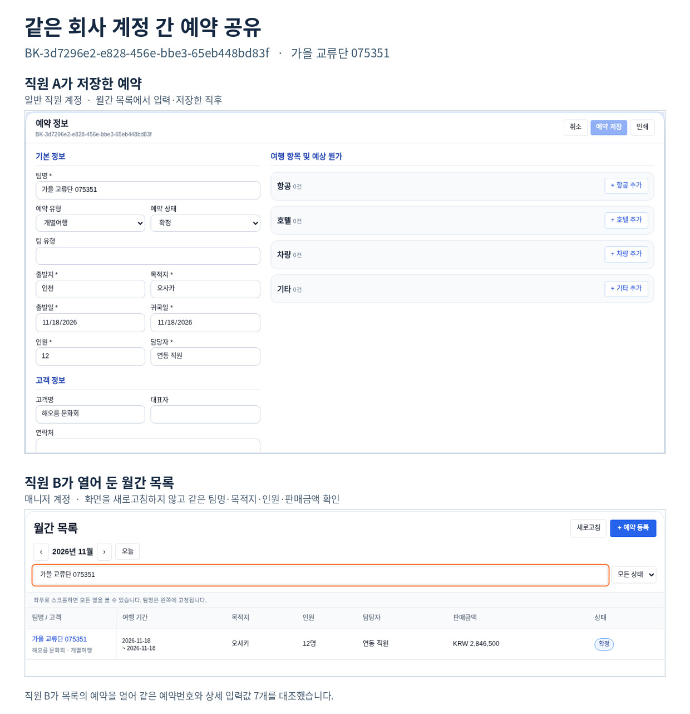

# 같은 회사의 여러 계정으로 확인한 Entrip

2026년 11월 18일, 일반 직원이 캘린더에서 예약을 저장하고 같은 회사 매니저가 이미 열어 둔 화면에서 그 예약을 확인했다. 월간·주간 캘린더, 월간·주간 목록, 예약 상세에서 등록·수정·취소·삭제를 측정한 18건이 모두 새로고침 없이 **164~200ms** 안에 반영됐다. 별도 회사 계정으로 같은 예약번호를 검색한 결과는 0건이었고 같은 예약 상세를 직접 요청하면 404를 받았다.



위 화면은 별도 예약인 오사카 12명·2,846,500원 건이다. 저장 응답 후 136ms 만에 매니저의 열린 목록에서 보였고, 예약번호와 상세 입력값 7개가 일치했다.

[기능별 측정 결과](verification/2026-11-18/multi-account/summary.json)

## 계정과 측정 환경

배포용 코드를 빌드한 웹·API·게이트웨이와 독립된 SQLite DB를 실행했다. 한 회사의 관리자 1명, 매니저 2명, 일반 직원 1명과 다른 회사 관리자 1명이 실제 로그인 화면을 거쳤다. 예약 시험에서는 이 5개 계정 중 직원·매니저·다른 회사 관리자 계정으로 서로 쿠키와 브라우저 저장소를 공유하지 않는 Chromium 세션 8개를 열었다.

읽는 화면을 먼저 열고 다른 계정에서 저장했다. 예약 시간은 서버의 저장 성공 응답부터 상대 화면에서 값이 처음 관측될 때까지다. 이전 버전의 등록·수정·취소·삭제 관측 15건은 12초를 기다린 뒤 직접 새로고침해야 반영됐다. 아래 시간은 이 검증 환경의 관측값이다.

## 메뉴별 확인

| 메뉴 | 실제 조작과 확인 결과 |
| --- | --- |
| 월간·주간 캘린더, 월간·주간 목록 | 직원이 캘린더 날짜를 눌러 등록한 예약이 매니저의 네 화면에 177~179ms 만에 나타났다. 인원 6명과 판매금 2,867,000원이 일치했다. 매니저의 수정이 직원 목록에 177ms 만에 반영됐다. 취소 후 상태 필터로 찾을 수 있었고 인원·판매 합계에서 빠졌다. 삭제 후 다섯 개의 열린 조회 화면에서 사라졌다. |
| 예약 정보·변경 이력 | 매니저가 다시 연 예약의 고객·연락처, 항공·호텔·차량·기타 항목의 수량·단가·통화 등 **42개 값**을 대조했다. 호텔 단가 JPY 18,300→19,100과 변경자 이름이 이력에 표시됐다. 다른 직원이 수정하면 깨끗한 상세는 자동 갱신되고, 입력 중이면 경고와 초안이 남았다. 오래된 버전으로 저장하면 412를 받았고 ‘다시 불러오기’로 먼저 저장된 값을 복구했다. 다른 직원이 삭제하면 깨끗한 상세는 닫히고 편집 중이던 상세에는 메모와 삭제 표시가 남았다. |
| 예약 인쇄 | 매니저가 인쇄 버튼으로 만든 예약서를 PDF로 저장해 예약번호, 네 여행 항목, 편명, 객실·차종, 판매금·입금·잔액 등 **13개 값**을 대조했다. 원래 예약서와 삭제 후 남은 초안은 각각 A4 한 장이었고, 삭제된 문서 머리말에는 ‘삭제된 예약의 미저장 초안’이 표시됐다. 두 PDF를 이미지로 열어 표, 금액, 마지막 메모와 페이지 번호를 확인했다. |
| 대시보드·캘린더 실적·종합 통계 | 예약 등록 후 세 화면의 집계가 자동 변경됐다. 담당자 통계에서 1건·7명·723,459원을 대조했다. 취소 후 대시보드와 통계의 수치가 내려갔다. 다른 회사의 통계에는 이 담당자의 예약이 없었다. |
| 항공편 조회 | 두 계정에서 부산→오사카 운항표의 요일 칸 35개가 일치했다. 한 사용자가 울란바토르로 바꾸면 다른 사용자는 오사카에 머물렀다. 울란바토르 PDF에는 BX796이, 다른 사용자의 화면에는 오사카 BX122가 표시됐다. 사용한 자료는 운항 일정 스냅샷이다. |
| 계좌 관리·입출금 | 계좌 개설·이름과 기초잔액 변경·빈 계좌 삭제, 대기 입금 편집·승인·반려를 시험했다. 일반 직원에게 쓰기 제어가 숨겨졌고 다른 회사 목록에 계좌가 없었다. 대기·반려 때 잔액은 유지됐고 승인한 거래가 한 번만 적용됐다. 최종 USD 1,350이 원장·PDF·재조회 결과에서 일치했다. 계좌와 대기 거래를 동시에 편집하면 먼저 저장한 값과 상대 초안이 모두 보존됐다. |
| 결재 | 지정한 두 매니저가 순서대로 결재했다. 1차 승인까지 잔액이 유지되고 최종 승인에서 한 번 출금됐다. 자기 결재·순서·역할 제한, 반려 사유, 처리 전 취소, 필터 결과와 두 결재 의견의 PDF를 대조했다. 계좌·거래·결재에서 측정한 16건 모두 열린 화면에 0.01~0.22초 안에 반영됐다. |
| 맞춤설정·직원 관리 | 관리자의 직원 등록·이름/부서/권한 변경·비활성·재활성화를 다른 계정의 열린 명부와 조직도에서 확인했다. 승격·강등은 이미 로그인한 세션에도 적용됐다. 비활성 직원은 로그인 화면으로 돌아갔고 기존 쿠키로 401을 받았다. 재활성화 후 동일 ID와 기존 비밀번호로 로그인했다. 명부·직원 양식 PDF에서 필터와 입력값을 대조했고 비밀번호는 출력되지 않았다. |
| 메신저·직원 찾기 | 1:1 대화 생성과 답신, 여러 줄 메시지, 입력 중 표시, 읽지 않음·읽음, 본인 메시지 수정·삭제, 그룹 초대와 답신을 확인했다. 초대 전 제3자에게 대화가 보이지 않았고, 다른 회사의 직원과 그룹은 검색되지 않았다. 새 메시지를 51회 실제 전송한 별도 시험에서 최근 50건과 이전 내역을 중복 없이 연결해 55건을 확인했다. 대화·조직도 PDF도 대조했다. 직원·메신저 본 시험은 30개 항목을 통과했다. |
| 작업 탭·프로필·도움말 | 프로필·도움말, 헤더 바로가기, Ctrl+메뉴·새 작업으로 독립 탭 열기, 키보드 이동과 미저장 탭 닫기 취소를 확인했다. 같은 계정의 별도 브라우저와 다른 사용자의 작업 화면에 작성 중인 초안이 나타나지 않았다. 현재 탭에서는 새로고침 후에도 초안과 반복 항목이 보존됐다. |
| 메일·업무 자동화·외부 바로가기 | 두 계정에서 메일 계정 미연결과 자동화 실행 미제공 안내를 확인했다. 지도는 외부 지도 주소를 여는 동작, 환율은 헤더에 표시된 통화별 값을 확인했다. 실제 메일 송수신, 외부 자동화 실행, 항공사 실시간 운항 대조는 수행하지 않았다. 메신저의 파일 첨부·이모지 반응·수동 온라인 상태 설정은 현재 제공되지 않는다. |

환율을 표시하는 탭이 많아지면 익명 요청 한도가 소진돼 새 로그인이 지연되는 현상을 재현했다. 공개 환율 조회의 요청 한도를 분리하고, 동일 환율 요청을 합쳐 60초 동안 재사용하도록 수정했다. 최종 서버에서 두 직원의 신규 로그인, 로그아웃 후 보호된 조회의 401 응답, 다른 계정으로 재로그인을 확인했다. 로그인 자체의 횟수 제한은 유지했다.

## 재접속과 데이터 보존

- 조회 중이던 직원 B의 연결이 끊긴 사이 직원 A가 정상 연결에서 예약을 저장했다. 직원 B의 연결이 복원된 뒤 384ms 만에 열린 화면에 그 예약이 나타났다. 실시간 연결을 계속 차단한 경우에는 정기 재조회로 19.592초 뒤 나타났다. 두 경우 모두 브라우저 재로딩은 0회였고 다른 회사 계정에 전달된 예약 알림도 0건이었다.
- 웹·API 재시작 후 독립 직원 브라우저에서 같은 예약 ID·예약번호·입력값 7개와 버전 2를 확인했다. 별도로 복원한 백업은 입금 13,729와 생성 이력을, 현재 DB는 나중에 반영한 입금 20,729와 생성·수정 이력을 보존했다. 복원 DB의 SQLite 무결성·외래 키 검사도 통과했다.
- 게이트웨이가 모든 IPv4 인터페이스에서 수신하는 것을 확인했다. 이번 시험에서는 한 호스트의 격리된 브라우저를 사용했다. 실제 사내 PC 두 대 사이의 연결과 Windows 방화벽 통과 여부는 해당 네트워크에서 확인해야 한다. [Windows 실행 및 LAN 접속 안내](ENTRIP_RUN_GUIDE.md) · [여행사·기기·변경 이력 DB 구조](ENTRIP_SQLITE_LAN.md)

## 전체 메뉴 출력 검사

이번 SQLite 배포 후보에서 전체 메뉴 인쇄 시나리오를 다시 실행했다. **PDF 27건·38쪽에서 원본 값 679개가 일치**했다. 대시보드·예약·항공·금융·결재·직원·메신저·메일·자동화·작업 탭·로그인 출력에서 누락된 기대값이나 비공개 값의 혼입은 검출되지 않았다. 로그인 입력값, 다른 탭의 예약, 직원 비밀번호도 인쇄 문서에서 제외됐다.

이전 인쇄 검사에서는 PostgreSQL 검증 앱에서 실제 메뉴를 순회하며 만든 PDF **42건·61쪽**을 렌더링했다. 기본 인쇄 시나리오에서 원본 값 740개를 대조했고, 밀집 월간 캘린더의 예약 133개 항목, 세 장에 걸친 여행 항목 41개, 항공표 42개 요일 칸도 확인했다. 이번 SQLite 다중 계정 시험은 다른 직원이 저장한 원본·조회 조건·편집 초안이 출력물까지 이어지는지 확인했다. [화면별·양식별 검사 내역](ENTRIP_BOOKING_PRINT_20261118.md) · [전체 PDF 견본](verification/2026-11-18/booking-print/Entrip_Print_Review_20261118.pdf)

## 같은 조건으로 재현하기

폐기 가능한 별도 DB에 위 다섯 계정을 준비한다. 계정마다 브라우저 컨텍스트를 따로 열어 로그인한 뒤 Playwright의 로그인을 포함한 저장 상태를 비공개 디렉터리에 `admin.json`, `manager.json`, `manager2.json`, `staff.json`, `other.json`으로 저장한다. 일반 직원과 매니저가 같은 회사 코드이고 다른 회사 관리자는 별도 코드인지 프로필에서 확인한다.

저장소 루트에서 `BASE_URL`에 시험 호스트 주소, `QA_STATE_DIR`에 저장 상태 디렉터리, `VERIFICATION_OUTPUT_DIR`와 `QA_FINANCE_OUTPUT`에 결과 디렉터리를 지정한다. `QA_COMPANY`, `QA_OTHER_COMPANY`와 각 역할의 `QA_<역할>_EMAIL`, `_PASSWORD`, `_ID`, `_NAME`은 생성한 시험 계정과 맞춘다. Chromium 및 PDF 문자 추출용 `pdftotext`가 필요하다. 아래 명령은 서로의 로그인 속도 제한에 영향을 주지 않도록 차례로 실행한다.

```sh
export LAN_SMOKE_DISPOSABLE=1 ENTRIP_DISPOSABLE_QA=1
export BOOKING_REQUIRE_PASSIVE=1 QA_REQUIRE_PASSIVE=1 QA_REQUIRE_LIVE=1
node scripts/verification/verify-company-bookings.mjs
node scripts/verification/verify-company-finance.mjs
node scripts/verification/verify-company-people.mjs
node scripts/verification/verify-company-views.mjs
```

최종 배포 ZIP을 풀어 빌드한 서버에서 예약 18회, 계좌·결재 16회, 직원·메신저 30개 검사와 대시보드·통계·항공·개인 작업 탭 검사를 다시 통과했다. 공유·웹·UI 단위/계약 테스트 388개와 SQLite API 테스트 95개가 통과했다.

최종 ZIP에서도 12개 업무 메뉴와 추가 양식을 다시 PDF 27건·38쪽으로 출력했다. 대조한 값 683개 가운데 누락 0개, 금지한 값 노출 0개였으며 브라우저 오류도 없었다.
