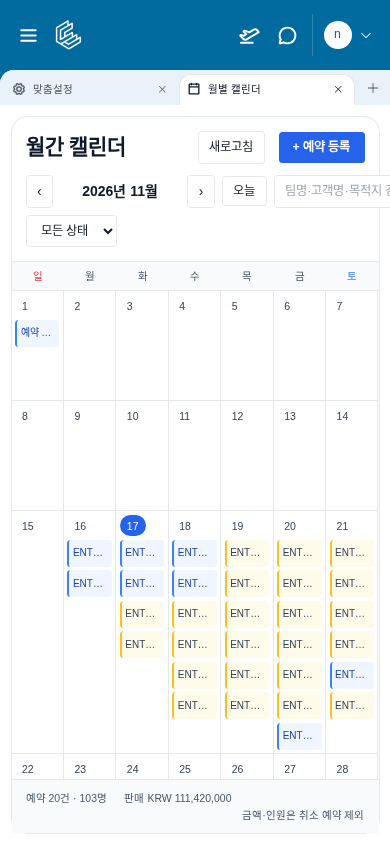

# Entrip 전체 메뉴·기능 시각 점검 — 2026-11-17

**판정: 기본 메뉴는 모두 열리지만, 현재 화면을 완성판으로 판정할 수 없다.** 모바일 예약 검색창 잘림, 과거 메시지 조회 위치 상실, 동작하지 않는 더보기, 메뉴 이름과 실제 목적지 불일치가 재현됐다. 메일·자동화는 미완성이며 실제 항공·환율 연동 성공은 이번 환경에서 확인하지 못했다.

검토 대상 앱 커밋: `aa2232cf7109b25a61610b2bdb88c665da4e324f`. 이번 변경은 점검 자료와 재촬영 도구이며 **앱 소스 수정·운영 배포는 하지 않았다.**

## 확인 범위와 증거

- 사이드바 기본 목적지 **12개 전체**를 1440×1000, 800×1000, 390×844에서 열었다. 헤더 아이콘, 모바일 메뉴, 작업 탭, 사용자 메뉴, 직접 URL 7개도 확인했다.
- 등록·수정·검색·빈 결과·오류·권한별 화면을 포함한 **124장**을 실제 렌더링 후 직접 시각 검토했다. 문서의 폭 수치만으로 정상 판정하지 않았다.
- 실제 Next.js 프로덕션 빌드, 실제 API, 임시 PostgreSQL과 데모 계정을 사용했다. 예약 생성/수정/삭제, 결재 요청/반려, 메시지 전송/수정/삭제/초대, 직원 생성/편집/비활성/재활성을 실제 UI에서 수행했다.
- 독립 재촬영 도구도 실행했다. 36개 메뉴·너비 조합과 43장 수집 완료, 페이지 JS 오류 0건, 수집 실패 0건. 자동 수집의 `COLLECTION_COMPLETE_REQUIRES_HUMAN_REVIEW`는 화면 합격을 의미하지 않는다. 내부 잘림 후보 28개 중 표의 의도된 가로 스크롤도 포함돼 있어 사람이 구분했다.
- [124장 전체 캡처 목록](verification/2026-11-17/menu-audit/README.md), [재촬영 결과](verification/2026-11-17/menu-audit/collector-summary.json), [이미지 무손실 검증](verification/2026-11-17/menu-audit/image-manifest.json).

## 먼저 고칠 문제

P1은 기본 조작을 방해하는 문제, P2는 실제 사용의 혼동·맥락 상실·출력 품질 문제, P3는 표시·안내 개선이다.

| ID | 우선순위 | 재현된 문제 | 영향 / 수정 기준 | 화면 증거 |
|---|---|---|---|---|
| V01 | P1 | 모바일 예약 4종의 검색창 오른쪽이 잘림 | 390px에서 입력 오른쪽 끝 413.84px. 페이지 자체 폭은 390px여도 내부 입력이 숨는다. 검색 영역을 다음 행에 온전히 배치 | [월간](verification/2026-11-17/menu-audit/responsive-390-month-calendar.webp), [주간](verification/2026-11-17/menu-audit/responsive-390-week-calendar.webp), [좌표](verification/2026-11-17/menu-audit/search-clipping.json) |
| V02 | P2 | 메신저 ‘이전 메시지’ 클릭 후 최신 메시지로 이동 | 과거 내역을 읽으려다 위치를 잃음. prepend 때 기존 메시지 위치 보존 필요. scrollTop 0→6740 | [이전](verification/2026-11-17/menu-audit/72-messenger-history-before.webp), [이후](verification/2026-11-17/menu-audit/73-messenger-history-after.webp), [측정](verification/2026-11-17/menu-audit/history-scroll.json) |
| V03 | P2 | 대시보드 ‘+22건 더보기’ 클릭 무반응 | 실제 링크/버튼이 아닌 텍스트. 전체 예약 목록으로 연결하거나 표시 자체를 바꿔야 함 | [클릭 후](verification/2026-11-17/menu-audit/23-dashboard-more-noop.webp) |
| V04 | P2 | ‘프로필 설정’이 직원·권한 관리로 이동 | 개인 프로필 편집 화면이 없음. 메뉴 목적에 맞는 화면 또는 정확한 명칭 필요 | [메뉴](verification/2026-11-17/menu-audit/19-user-help.webp), [목적지](verification/2026-11-17/menu-audit/20-profile-destination.webp) |
| V05 | P2 | 모바일 캘린더에서 예약명이 거의 모두 `ENT...` | 7열에서 팀을 식별하기 어려움. 모바일 일별 목록/선택 날짜 상세 등 식별 가능한 대안 필요 | [390px](verification/2026-11-17/menu-audit/responsive-390-week-calendar.webp) |
| V06 | P2 | 캘린더의 대기·진행·완료가 같은 연노랑, 상태 문구 없음 | 목록에는 다른 상태지만 캘린더만 보면 구별 어려움. 색과 텍스트/배지 병행 | [캘린더](verification/2026-11-17/menu-audit/04-week-calendar.webp), [목록](verification/2026-11-17/menu-audit/06-week-list.webp) |
| V07 | P2 | 취소·반려 결재의 미진행 단계가 계속 ‘대기’ | 종료된 결재가 후속 처리 대기처럼 보임. ‘미진행/종료’로 구분 | [반려](verification/2026-11-17/menu-audit/57-approval-rejected-mobile.webp), [취소](verification/2026-11-17/menu-audit/09-approval.webp) |
| V08 | P2 | 예약 변경 이력에 `teamName`, `hotelInfo`, `insuranceInfo` 노출 | 업무 용어로 읽을 수 없음. 한국어 필드명과 변경 전후 값 필요 | [이력](verification/2026-11-17/menu-audit/42-booking-history.webp) |
| V09 | P2 | 인쇄표의 ‘수량’·날짜·금액 줄바꿈 불량 | 긴 상세 설명이 좁은 열을 압박. 날짜·수량·금액 폭 확보, 설명만 자연스럽게 줄바꿈 | [인쇄](verification/2026-11-17/menu-audit/43-booking-print-all-services.webp) |
| V10 | P2 | `/dashboard`, `/reservations` 직접 진입 시 공통 탐색 사라짐 | 북마크/직접 URL 사용 시 헤더·사이드바·작업 탭 없음. 정식 경로로 통합/리다이렉트 | [dashboard](verification/2026-11-17/menu-audit/33-legacy-dashboard.webp), [reservations](verification/2026-11-17/menu-audit/34-legacy-reservations.webp) |
| V11 | P2 | 10개 작업 탭에서 마지막 활성 탭 제목·닫기가 초기 화면 밖 | 새로 활성화된 탭이 자동으로 온전히 보이지 않음. 활성 탭을 스크롤 영역 안으로 이동 | [10개 탭](verification/2026-11-17/menu-audit/90-tabs-limit.webp) |
| V12 | P2 | 예약 조회 실패와 ‘예약 없음/0건’이 함께 표시 | 장애가 실제 예약 부재처럼 읽힐 수 있음. 오류 시 빈 결과·0건 확정 표시를 분리 | [오류 주입](verification/2026-11-17/menu-audit/94-booking-error-fixture.webp), [재시도 복구](verification/2026-11-17/menu-audit/95-booking-retry-recovered.webp) |



## 추가 완성도 문제

| ID | 우선순위 | 관찰 / 권장 조치 | 근거 |
|---|---|---|---|
| V13 | P2 | 직원·예약·거래·항공 표를 가로 스크롤하면 식별 열이 사라짐. 핵심 이름/항공사 열 고정, 스크롤 안내 필요 | [직원 우측](verification/2026-11-17/menu-audit/84-settings-mobile-right.webp), [항공 우측](verification/2026-11-17/menu-audit/76-flights-snapshot-mobile-right.webp) |
| V14 | P3 | 담당자별 ‘건수’ 차트에 0.25/0.5/0.75 눈금, 과밀한 이름; 툴팁에는 `value : 0` | [통계](verification/2026-11-17/menu-audit/07-stats.webp), [차트 하단](verification/2026-11-17/menu-audit/24-dashboard-bottom.webp) |
| V15 | P3 | 거래가 있는 계좌의 통화/기초잔액을 편집하게 한 뒤 저장에서 거절. 잠긴 값은 처음부터 읽기 전용으로 표시 | [실제 저장 거절](verification/2026-11-17/menu-audit/91-account-immutable-error.webp) |
| V16 | P3 | 메신저 직원 검색 0건에 안내 없음 | [빈 검색](verification/2026-11-17/menu-audit/63-messenger-empty-search.webp) |
| V17 | P3 | 잘못된 로그인 시 `Invalid email or password` 영어 그대로 표시 | [로그인 오류](verification/2026-11-17/menu-audit/87-login-error-mobile.webp) |
| V18 | P3 | 항공 목적지 `NRT - NRT` 중복 표기, 활성/비활성 공항 선택의 시각 차이 약함 | [항공표](verification/2026-11-17/menu-audit/74-flights-snapshot-desktop.webp), [초기](verification/2026-11-17/menu-audit/08-flights-initial.webp) |
| V19 | P3 | `/icon-test` 개발용 화면이 운영 빌드에 남음. `/calendar-week` 별칭의 탭 제목은 ‘작업’ | [개발 화면](verification/2026-11-17/menu-audit/35-icon-test.webp), [별칭](verification/2026-11-17/menu-audit/32-week-alias.webp) |
| V20 | P3 | 예약 검색 0건과 빈 기간 문구가 동일, 1/1 페이지 이전·다음 비활성 차이가 약함, 모바일 통계 단위만 다음 줄로 분리 | [검색](verification/2026-11-17/menu-audit/37-booking-search-empty.webp), [통계](verification/2026-11-17/menu-audit/responsive-390-stats.webp) |

## 메뉴별 확인 결과

| 메뉴 | 직접 확인한 동작·화면 | 판단 |
|---|---|---|
| 대시보드 | KPI, 예약/업무/팀 목록, 아래쪽 차트, 새로고침, 더보기 클릭 | 표시 정상, 더보기·차트 문구 개선 필요 |
| 월별 캘린더 | 날짜별 카드, 기간 이동/오늘, 상태/검색, 날짜 셀 등록, 상세 편집 | 모바일 검색·식별·상태 구분 문제 |
| 주별 캘린더 | 7일 범위, 다일 일정, 기본/별칭 경로, 반응형 | 같은 모바일 문제, 별칭 탭 명칭 문제 |
| 월별 리스트 | 검색 0건, 5개 상태 필터, 빈 기간, 이전/다음/오늘, 상세·금액, 우측 열 스크롤 | 데이터·조작 확인, 모바일 검색 잘림 |
| 주별 리스트 | 주간 범위와 7개 열, 상세 진입, 세 너비 | 표시 확인, 모바일 검색 잘림 |
| 운영현황 | 월/분기/연도 전환, KPI, 차트, 담당자 표 하단 | 표시 정상, 눈금·툴팁·밀도 개선 |
| 항공편 | 출발 전 도착 비활성, PUS 조회/재시도 실패, 저장 자료 시간표/모바일 우측/오래된 자료/빈 결과 | 실제 외부 연동은 미검증, fixture 화면만 검증 |
| 결재 | 요청, 금융 거래 연결, 결재자 2명, 상태 필터, 다른 결재자의 의견·반려, 반려 후 잔액 불변 | 실제 흐름 확인, 종료 단계 문구 개선 |
| 계좌관리 | 계좌 추가·거래 폼, 기존 거래 계좌 편집 거절, 통화/잔액/입출금 표, 우측 상태 열, 일반 직원 조회 | 표시·권한 정상, 잠긴 필드/표 식별 개선 |
| 메신저 | 대화/조직도·검색, 1:1, Enter/Shift+Enter, 긴 글·URL, 수정/삭제, 초대/3인방, 모바일 복귀, 과거 조회, 전송 실패 시 초안 보존 | 과거 조회 스크롤 결함, 0건 안내 누락 |
| 메일 | 연결 안 됨 안내, 계정 없음 | 수신/발송/첨부 미구현, 사용 불가 |
| 맞춤설정 | 검색·활성만, 직원 추가/편집/비활성/재활성, 본인 권한 잠금, 관리자·일반 직원 화면, 모바일 모달 | 계정 관리 정상, 개인 프로필 기능은 없음 |
| 공통/추가 경로 | 헤더 내부 아이콘, 로고, 메뉴 접기, 모바일 메뉴, 도움말, 로그인/실패/로그아웃, Ctrl 새 탭·Alt 순서·10개 제한, 새 작업, 직접 URL | 10개 탭/프로필/legacy 경로 문제; 지도 본문은 외부 접속 제한으로 미확인 |

예약 상세에서는 호텔·항공·차량·기타 네 종류 추가, 호텔 반복 행 추가/삭제 후 남은 값 보존, 여러 통화, 합계, 저장/재조회, 미저장 닫기 취소, 수정 저장, 테스트 예약 삭제, 변경 이력과 인쇄까지 확인했다. 모바일 하단 삭제·닫기·저장 버튼은 실제로 모두 화면 안에 있었다. 초기 소스 검토의 하단 잘림 우려는 결함 목록에서 제외했다.

직원 생성 후 편집/비활성/재활성을 확인한 테스트 계정은 마지막에 비활성화했다. 예약 테스트 레코드는 삭제했다. 반려된 거래는 승인 잔액에 반영되지 않았다. 모든 작업은 임시 테스트 DB에서 이루어졌다.

## 확인하지 못한 범위와 fixture 구분

- **메일·업무 자동화:** 화면 자체가 미구현을 명시한다. 받은 메일·발송·첨부·자동화 실행을 완료로 계산하지 않았다. OCR/외부 문서 연동도 기존 완성 범위에 포함되지 않는다.
- **실시간 항공·환율:** 현재 서버는 항공 조회와 환율에 503/연결 실패를 반환했다. 74~78 항공표는 저장소의 2025-07-29 PUS 자료를 브라우저 응답 fixture로 넣은 것이다. 과거 자료·비실시간임을 화면에 명시했고, 현행 운항 정보나 실제 서비스 연결 성공의 증거로 쓰지 않았다.
- **지도:** 버튼이 새 창을 여는 것은 확인했지만 외부 접속은 Chrome 오류 페이지로 끝났다. 실제 지도 본문 조작은 미확인이다.
- **히스토리 부하 준비:** 짧은 시간에 API로 메시지를 넣자 정상적으로 429가 발생했다. 과거 내역 검토용 55개 합성 메시지를 임시 PostgreSQL에 준비한 뒤 실제 UI의 과거 조회 버튼·스크롤을 검사했다.
- **오류 상태:** 예약 조회 503과 메시지 전송 503은 명시적인 테스트 오류 주입이다. 예약의 재시도 복구와 메시지 초안 보존을 확인했다. 실제 통신이 전부 끊어진 OS 수준 오프라인 검증과는 다르다.
- **입력 중 표시:** 활성 composer에서 typing 이벤트 호출이 없다는 소스 확인은 했으나, 두 클라이언트로 별도 재현하지 않았다. 시각 검증 완료 항목에 넣지 않는다.
- **모바일 조건:** 390px 브라우저 viewport 검토다. 실제 휴대폰 가상 키보드·터치 키보드·OS 인쇄창·여러 브라우저 조합은 별도 검증이 필요하다. 인쇄는 HTML 출력 화면을 확인했으며 실제 종이 인쇄/PDF 페이지 분할은 미검증이다.
- **기존 기능 검증과 구분:** 앞선 413개 테스트 및 예약·작업탭·금융·메신저·직원 관리 5개 흐름 결과는 기존 [검증 보고서](ENTRIP_VERIFICATION_20261117.md)에 있다. 이번 124장의 시각 점검 결과를 그 테스트 수와 합치거나 ‘전체 기능 합격’으로 표현하지 않는다.

## 재촬영

실행 중인 웹/API와 데모 계정을 대상으로 다음 도구를 사용한다. 새 실행 폴더를 생성해 기존 증거를 덮어쓰지 않으며 업무 레코드를 변경하지 않는다. 화면 데이터는 사용 계정 권한에 따라 달라진다.

```bash
BASE_URL=http://127.0.0.1:3000 node scripts/verification/verify-menu-audit-ui.mjs
```

필요하면 `BROWSER_EXECUTABLE_PATH`, `TEST_COMPANY`, `TEST_ROLE`, `TEST_EMAIL`, `TEST_PASSWORD`, `VERIFICATION_OUTPUT_DIR`을 지정한다. 이번 환경에서는 이미 설치된 Chromium headless shell을 사용했다. 수집 도구 문법 검사, 도움말 실행, 실제 36개 조합 수집을 완료했다.

[탐색·대시보드·설정 상세 리뷰](verification/2026-11-17/menu-audit/navigation-review.md) · [예약·금융·결재·메신저 상세 리뷰](verification/2026-11-17/menu-audit/feature-review.md)

공개판에는 판독 보고서·캡처·수치/해시 검증 자료를 게시한다. 원시 관측 본문, 계정·거래별 JSON, ARIA 덤프와 환경 로그는 제외한다.


최초 점검 캡처 124장과 수정 후 캡처 87장을 공개했다.
